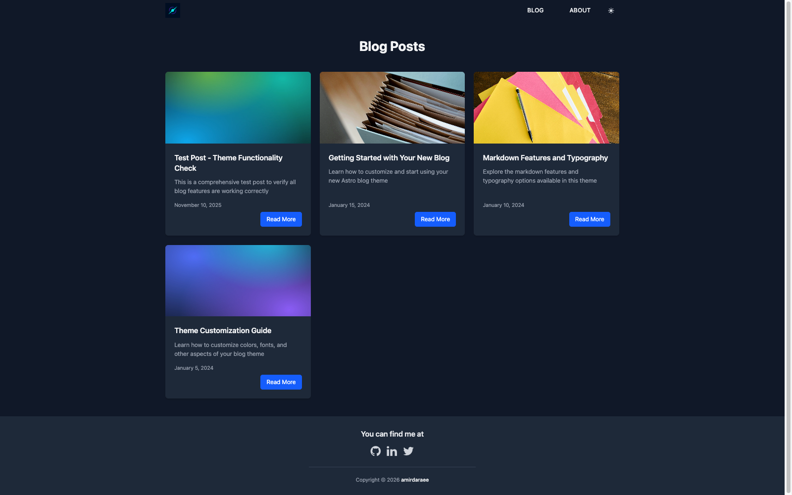

<!-- wasmer:start -->
## Deploy on Wasmer

This folder is the [Pulsar](https://github.com/amirdaraee/astro-pulsar) Astro theme by amirdaraee, copied from commit `310b8da4eea222775b03bf999c852e3797fbdf44` so it can be deployed as a Wasmer Edge template.

- **Demo:** https://astro-pulsar.wasmer.app
- **Deploy:** open the template on [wasmer.io/templates](https://wasmer.io/templates) and click **Deploy**, or run `wasmer deploy` in this folder. Wasmer installs with npm, runs the build script with Node 24 and serves the static `dist/` folder.
- **Changed for Wasmer:**
  - Resized 3 images over 300 KB to at most 1600 px wide, keeping file names and formats.
- **Environment variables:** None.
- **Credit:** theme by [amirdaraee](https://github.com/amirdaraee), MIT. The theme's license file is kept unchanged.
<!-- wasmer:end -->

# Pulsar

⚡ A fast, modern Astro blog theme with flash-free dark mode, Shiki syntax highlighting, RSS, tag pages, and comprehensive SEO — built with Tailwind CSS, ready to use out of the box and personalized through a single config file.



## Features

- ✨ **Modern Design** - Clean, professional design with attention to typography and spacing
- 🌙 **Dark Mode** - Toggle between light and dark themes with localStorage persistence
- 🚀 **SEO Optimized** - Built-in meta tags, Open Graph, Twitter Cards, and structured data
- ♿ **Accessible** - ARIA labels, semantic HTML, keyboard navigation, and skip-to-content link
- 📱 **Responsive** - Mobile-first design that looks great on all devices
- ⚡ **Fast** - Built with Astro for optimal performance and minimal JavaScript
- 🎨 **Customizable** - Easy-to-use configuration file for personalizing your blog
- 🔍 **Syntax Highlighting** - Shiki with GitHub light/dark themes that follow the site theme
- 📝 **Markdown Support** - Write content in Markdown with full formatting support
- 🗺️ **Sitemap** - Automatic sitemap generation for better SEO
- 📊 **Google Analytics** - Production-only GA4 with content groups, post dimensions, theme user property, and read-completion events (optional)
- 📡 **RSS Feed** - Auto-generated feed at `/rss.xml` with autodiscovery
- 🏷️ **Tag Pages** - Static tag index and per-tag listings from post keywords
- ⏱️ **Reading Time** - Estimated reading time on every post
- 🔀 **Post Navigation** - Previous/next links between posts
- 🤖 **Automated Releases** - release-please versioning and changelog generation

## Tech Stack

- **Framework:** [Astro](https://astro.build)
- **Styling:** [Tailwind CSS](https://tailwindcss.com)
- **Language:** [TypeScript](https://www.typescriptlang.org)
- **Syntax Highlighting:** [Shiki](https://shiki.style)
- **Icons:** [Font Awesome 4.7](https://fontawesome.com/v4)

## Quick Start

### 1. Clone or Use This Template

```bash
# Clone the repository
git clone https://github.com/amirdaraee/astro-pulsar.git my-blog

# Navigate to the directory
cd my-blog

# Install dependencies
npm install
```

Or use as a template directly on GitHub.

**Quick start with npm:**
```bash
npm create astro@latest -- --template amirdaraee/astro-pulsar
```

### 2. Configure Your Site

Edit `src/config.ts` to personalize your blog:

```typescript
export const SITE_CONFIG = {
  title: "My Awesome Blog",
  description: "Thoughts on web development, design, and more",
  author: "amirdaraee",
  email: "amirdaraee@gmail.com",

  socialLinks: {
    github: "amirdaraee",
    twitter: "amirdaraee",
    linkedin: "amirdaraee",
    youtube: "yourchannel", // Leave empty if not used
  },

  googleAnalyticsId: "G-XXXXXXXXXX", // Optional
  language: "en",
  locale: "en-US",
  siteUrl: "https://yourdomain.com",
};
```

### 3. Update Site URL

Edit `astro.config.mjs`:

```javascript
export default defineConfig({
  site: 'https://yourdomain.com', // Your production URL
  // ... rest of config
});
```

### 4. Start Development Server

```bash
npm run dev
```

Visit `http://localhost:4321` to see your blog.

## Project Structure

```
/
├── public/              # Static assets
│   ├── fonts/          # Custom fonts
│   ├── stock/          # Stock images
│   ├── logo.png        # Site logo
│   └── favicon.png     # Favicon
├── src/
│   ├── components/     # Reusable components
│   │   ├── Header.astro
│   │   ├── Footer.astro
│   │   ├── SEO.astro
│   │   └── DarkModeToggle.astro
│   ├── content/
│   │   └── blog/       # Blog posts (markdown)
│   ├── content.config.ts # Content collections schema
│   ├── layouts/
│   │   └── Layout.astro # Main layout wrapper
│   ├── pages/          # File-based routing
│   │   ├── index.astro
│   │   ├── blog/
│   │   ├── about.astro
│   │   └── ...
│   ├── styles/
│   │   └── global.css # Tailwind entry point & theme customization
│   └── config.ts       # Site configuration
├── astro.config.mjs    # Astro configuration
└── package.json
```

## Creating Content

### Writing Blog Posts

Create a new `.md` file in `src/content/blog/`:

```markdown
---
title: "Your Post Title"
description: "A brief description of your post"
published: true
date: 2024-01-15
author: "amirdaraee"
keywords: ["keyword1", "keyword2"]
photo: "/stock/your-image.jpg"
language: "en"
---

# Your Content Here

Write your blog post content using Markdown...
```

### Adding Pages

Add new `.astro` files to `src/pages/` to create new routes:

```astro
---
import Layout from '../layouts/Layout.astro';
---

<Layout title="Your Page Title">
  <!-- Your page content -->
</Layout>
```

## Customization

### Navigation Menu

Edit the navigation items in `src/config.ts`:

```typescript
export const NAV_ITEMS = [
  { href: "/", label: "Home" },
  { href: "/blog", label: "Blog" },
  { href: "/about", label: "About" },
  // Add more items as needed, e.g. { href: "/tags", label: "Tags" }
];
```

### Colors and Styling

Pulsar uses Tailwind CSS v4, which is config-file-free — theme customization lives directly
in `src/styles/global.css`. Add your overrides with the `@theme` directive:

```css
@import "tailwindcss";

@theme {
  --color-primary: #your-color;
  --color-secondary: #your-color;
  --font-sans: "Your Font", sans-serif;
}
```

Additional global styles (beyond Tailwind utilities) can be added in
`src/layouts/Layout.astro` inside the `<style is:global>` block.

### Custom Fonts

1. Add font files to `public/fonts/`
2. Update `@font-face` rules in `src/layouts/Layout.astro`
3. Reference the font in `src/styles/global.css` via `@theme` (e.g. `--font-sans`)

### Google Analytics

To enable Google Analytics:

1. Add your GA tracking ID to `src/config.ts`
2. The tracking code loads automatically via the `Analytics` component (rendered in `Layout.astro`)

Tracking only runs in production builds, so dev and preview traffic never reaches your property. Beyond page views, the theme reports:

- `content_group` (`blog-post` vs `page`), plus `post_author` and `post_tags` dimensions on articles
- a `site_theme` user property (dark/light), updated by a `theme_toggle` event
- a `read_complete` event when a reader reaches the end of a post, with `reading_seconds` and `word_count`

To disable, leave `googleAnalyticsId` empty or set `features.analytics` to `false`.

## Building for Production

```bash
npm run build
```

The built site will be in the `dist/` folder (or the directory specified in `astro.config.mjs`).

## Deployment

### Netlify / Vercel

1. Connect your Git repository
2. Set build command: `npm run build`
3. Set publish directory: `dist`

### GitHub Pages

1. Update `astro.config.mjs`:
   ```javascript
   export default defineConfig({
     site: 'https://amirdaraee.github.io',
     outDir: './docs', // or '../docs'
   });
   ```
2. Push to GitHub
3. Enable GitHub Pages in repository settings, set source to the output directory

## Browser Support

- Chrome (latest)
- Firefox (latest)
- Safari (latest)
- Edge (latest)

## Releases

Versioning and release notes are fully automated with
[release-please](https://github.com/googleapis/release-please): write
[conventional commits](https://www.conventionalcommits.org/) (`feat:`, `fix:`, …)
and merge the auto-maintained Release PR when you want to cut a release.
See [.github/RELEASE.md](.github/RELEASE.md) for details.

### Conventional Commits

We follow [Conventional Commits](https://www.conventionalcommits.org/) for clear, structured commit messages:

- `feat:` - New features (minor version bump)
- `fix:` - Bug fixes (patch version bump)
- `docs:` - Documentation changes
- `style:` - Code style changes (formatting, missing semi-colons, etc.)
- `refactor:` - Code refactoring
- `perf:` - Performance improvements
- `test:` - Adding or updating tests
- `chore:` - Maintenance tasks

Example:
```bash
git commit -m "feat: add RSS feed support"
git commit -m "fix: resolve dark mode toggle issue on Safari"
git commit -m "docs: update installation instructions"
```

## Contributing

Contributions are welcome! Please:

1. Follow the [Conventional Commits](https://www.conventionalcommits.org/) specification
2. Update tests and documentation as needed
3. Ensure builds pass: `npm run build`
4. Submit a Pull Request

For more details, see [CONTRIBUTING.md](CONTRIBUTING.md).

## License

MIT License - feel free to use this theme for personal or commercial projects.

## Support

If you encounter any issues or have questions:

- Open an issue on [GitHub](https://github.com/amirdaraee/astro-pulsar/issues)
- Check the [Astro documentation](https://docs.astro.build)

## Credits

Built with:
- [Astro](https://astro.build)
- [Tailwind CSS](https://tailwindcss.com)
- [Font Awesome](https://fontawesome.com)

---

**Pulsar** - Made with ❤️ using Astro

> Named after pulsars, the highly magnetized rotating neutron stars that emit beams of electromagnetic radiation. Just like a pulsar, this theme delivers powerful, consistent performance with a bright, modern design. ⚡✨
