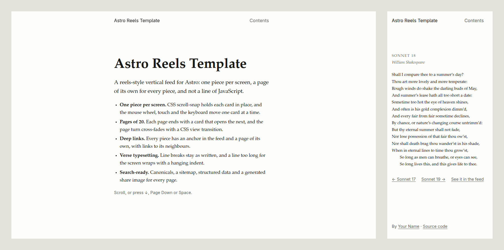

<!-- wasmer:start -->
## Deploy on Wasmer

This folder is the [Reels](https://github.com/cevdetch/astro-reels-template) Astro theme by cevdetch, copied from commit `53c9855c77e1bf60bce84143534d2529c766c12a` so it can be deployed as a Wasmer Edge template.

- **Demo:** https://astro-reels.wasmer.app
- **Deploy:** open the template on [wasmer.io/templates](https://wasmer.io/templates) and click **Deploy**, or run `wasmer deploy` in this folder. Wasmer installs with pnpm, runs the build script with Node 24 and serves the static `dist/` folder.
- **Changed for Wasmer:**
  - None. The theme builds as published.
- **Environment variables:** None.
- **Credit:** theme by [cevdetch](https://github.com/cevdetch), MIT. The theme's license file is kept unchanged.
<!-- wasmer:end -->

# Astro Reels Template

A reels-style feed of short pieces for [Astro](https://astro.build): one piece per screen, every
piece with its own page, and no JavaScript. The demo is all 154 of Shakespeare's sonnets.

**Live demo: [astro-reels-template.pages.dev](https://astro-reels-template.pages.dev/)**



## What you get

- **One piece per screen.** CSS scroll-snap holds each piece in place; the mouse wheel, touch and
  the keyboard (↓, Page Down, Space) move one card at a time.
- **Pages of 20.** `/`, `/page/2/`, … each end with a card that opens the next page, and the page
  change cross-fades with a CSS view transition. The last page ends with a closing card that
  leads to the contents and back to the start.
- **Deep links.** Every piece has an anchor in the feed (`/#18`, `/page/2/#25`) and a page of its
  own (`/sonnets/18/`) with links to its neighbours and back into the feed.
- **Contents.** `/sonnets/` lists every piece with its first line or title, linked from the
  header of every page, so readers can go straight to the one they want.
- **Verse typesetting.** Line breaks are kept as written. A line too long for the screen wraps
  with a hanging indent, so its remainder never reads as a new line; indented lines (such as a
  sonnet's closing couplet) keep their indent.
- **Search-ready.** Self-referencing canonicals, a sitemap, `robots.txt`, structured data
  (`WebSite`, and `CreativeWork` per piece), Open Graph tags and a generated share image for
  every page. Only the first feed page is indexed until you say the pieces are your own (see
  `indexPieces` below). The 404 page is `noindex`.
- **Accessible and fast.** Light and dark colours checked for contrast by a test, visible focus,
  no web fonts, and off-screen cards skipped by `content-visibility`. Lighthouse scores 100 for
  accessibility and best practices, and 100 for SEO on every page meant for search.

No page ships JavaScript, so the address bar does not follow the scroll and there is no native
share sheet; each piece's own page is the link to share.

## Requirements

- Node.js 24.8.0 or newer
- pnpm, the version pinned in `package.json` (`packageManager`)

## Start a project

```sh
pnpm create astro@latest my-site --template cevdetch/astro-reels-template
```

`my-site` is the folder to create. Add `--install --git --yes` to skip the questions.

Or create a repository with [Use this template](https://github.com/cevdetch/astro-reels-template/generate)
and clone it.

## Commands

| Command | Purpose |
| --- | --- |
| `pnpm install --frozen-lockfile` | Install dependencies |
| `pnpm dev` | Local dev server |
| `pnpm check` | Astro and TypeScript checks |
| `pnpm build` | Build the static site into `dist/` |
| `pnpm test` | Unit tests, and checks of the last build |
| `pnpm lint:html` | Audit `dist/` with [deadhead](https://www.npmjs.com/package/deadhead) |
| `pnpm verify` | All of the above, in order |

The tests in `tests/` hold for any site built from the template: they take their expectations
from `src/config.ts` and your content folder. `tests/demo/` checks the demo word for word and
skips itself once `pieces.name` is no longer `sonnets`.

## Project structure

```text
src/
├── config.ts                  Site details, the pieces' names, author, search: start here
├── content.config.ts          The pieces collection and its front matter
├── content/sonnets/           One Markdown file per piece (the folder pieces.name names)
├── components/
│   ├── Intro.astro            The welcome cards before the first piece
│   ├── FeedPage.astro         A feed page: pieces, page-turn cards, the closing card
│   └── PieceCard.astro        One piece, in the feed or on its own page
├── layouts/Layout.astro       Every page's <head>, header and footer
├── pages/
│   ├── index.astro            Feed page 1
│   ├── page/[page].astro      Feed pages 2 and on: /page/2/
│   ├── [section]/index.astro  The contents: /sonnets/
│   ├── [section]/[number].astro  A piece's own page: /sonnets/18/
│   ├── 404.astro
│   ├── robots.txt.ts
│   └── site.webmanifest.ts
├── lib/                       Paging, the pieces' words, SEO, structured data, verse lines
├── integrations/              Share images, rendered after the build
├── styles/site.css            The stylesheet: base.css (colours, type) and feed.css (cards)
└── assets/social-fonts/       Noto Sans, for share images only
public/                        Icons
scripts/                       The demo's import from Project Gutenberg
tests/                         Checks for any fork; tests/demo/ checks the demo
```

## Make it yours

1. **Site details.** Edit `src/config.ts`: the name, tagline, description, production `origin`, the
   line and credit on the welcome cards (leave `credit` out when you rewrite them), and `feedBase`
   if the feed should live somewhere other than `/`. `author` is a placeholder in the demo
   (`Your Name`, `https://example.com/`): set it to yourself, a name and the URL of your own site,
   and every page's footer credits you and the home page's `WebSite` structured data names you as
   its publisher. `repository` is your source code, linked from the footer. Either can be left
   out.
2. **Search.** `indexPieces` in `src/config.ts` is `false`, which suits demo text or text that is
   already published elsewhere, such as the sonnets: each piece's page and the feed pages after
   the first carry `<meta name="robots" content="noindex, follow">` and are left out of the
   sitemap, so search engines index only the first feed page but still follow its links. Set it
   to `true` when the pieces are your own, and every page goes into search and the sitemap.
3. **Welcome cards.** `src/components/Intro.astro` holds the cards before the first piece. They
   introduce this template; say what your site is instead. They are the text search engines read
   on your home page.
4. **Icons.** Replace the files in `public/`; the share images reuse `public/icon.svg`.
5. **Pieces.** Each piece is a Markdown file in the folder `pieces.name` names in
   `src/config.ts`, `src/content/sonnets/` in the demo:

   ```markdown
   ---
   number: 18
   title: "Sonnet 18"
   description: "Shall I compare thee to a summer’s day?"
   ---

   Shall I compare thee to a summer’s day?
   Thou art more lovely and more temperate:
     So long as men can breathe, or eyes can see,
   ```

   `number` sets the order: number the pieces 1, 2, 3 and on with no gaps, since the links between
   them follow the numbers, and a gap fails the build. A piece with `draft: true` is left out, so
   keep drafts at the end. `title` is the page title, and it is shown as the piece's heading when
   it says more than "Sonnet 18". `creator` is optional: it names a piece's own author, shown on
   the piece and in its structured data, in place of `pieces.creator`. `description` (up to 160
   characters) is the search snippet. The contents page lists each piece by its title, or by its
   first line when the title is only "Sonnet 18". Every line of the body is a line on the page.
   Start a line with two spaces or two em spaces to indent it; a blank line starts a new stanza.
   The body is shown as plain lines, not formatted Markdown.
6. **Name your pieces.** `pieces` in `src/config.ts` sets everything the pieces are called. `name`
   is the content folder, the collection and the URL segment: set it to `poems`, rename
   `src/content/sonnets/` to `src/content/poems/`, and pieces live at `/poems/18/`, with the
   `noindex` rule, the sitemap and the share-card label following. `label`, `plural` and `creator`
   are the words: a piece's page is headed "Sonnet 18" and signed "William Shakespeare", feed
   cards read "18 of 154", and links and page cards say "sonnets 21–40". A name that cannot be a
   folder and URL segment, or a folder with no pieces, fails the build. `book` names the book the
   pieces come from in their structured data; leave it out when they belong to none.
7. **Page size.** `PAGE_SIZE` in `src/lib/feed.ts`.
8. **Remove the demo.** Once your pieces are in, delete what only the demo uses: the sonnets in
   `src/content/sonnets/` (gone already if you renamed the folder), `scripts/` (the sonnets'
   import from Project Gutenberg), `tests/demo/` and `docs/screenshot.png`. Then rewrite this
   README for your site, and keep `LICENSE` as the License section says.

## Deploy

`pnpm build` writes a static site to `dist/`. Every URL ends in a slash (`/sonnets/18/`), which
static hosts such as Cloudflare Pages, Netlify and GitHub Pages serve from `index.html` files.
Set `origin` in `src/config.ts` to the production address first: canonicals, the sitemap and
share images use it.

## SEO checklist

What the template does for search:

- Every page has one title: `<Page> - <Site>`, or `<Site>: <tagline>` on the home page.
- Every page has a description of up to 160 characters (longer ones fail the build), a
  self-referencing canonical in the trailing-slash form, Open Graph tags, a 1200×630 share image
  and `twitter:card`. Each names Astro as its generator (`<meta name="generator">`).
- The home page carries `WebSite` structured data with the author as publisher; each piece's page
  carries `CreativeWork` with the piece's own author and book. `src/lib/identity.ts` assembles
  them from the builders in `src/lib/structured-data.ts`, typed with
  [schema-dts](https://github.com/google/schema-dts). A page's markup is one JSON-LD script
  holding an `@graph`, with `<` escaped so the data cannot close the element.
- `robots.txt` allows crawling and names the sitemap index. The sitemap lists only pages meant for
  search.
- The 404 page is served as `404.html`, `noindex` and without a canonical.
- Every page reads in full without JavaScript, and `pnpm lint:html` audits the built HTML.
- Every `<head>` is in [capo.js](https://rviscomi.github.io/capo.js/) order: charset and
  viewport, the title, the stylesheet, then everything else, which a test checks. The layout links
  `src/styles/site.css` itself, so add styles there or in the files it imports.

The index option, `indexPieces` in `src/config.ts`:

- `false` (the default, for demo text or text published elsewhere): each piece's page and the
  feed pages after the first carry `noindex, follow` and stay out of the sitemap. Only the home
  page is indexed, so it needs words of its own: the welcome cards.
- `true` (for your own pieces): every page except the 404 is indexed and listed in the sitemap.

What a fork must set before launch:

1. `origin` in `src/config.ts`: canonicals, the sitemap, `robots.txt` and share images use it.
2. `name`, `tagline` and `description`, written for the people searching for your site.
3. `author` and `repository`, or remove them.
4. `indexPieces`, as above.
5. The welcome cards in `src/components/Intro.astro`, and `pieces` in `src/config.ts` (including
   its `book`) with your content folder renamed to match.
6. Run `pnpm verify`, deploy, then submit `/sitemap-index.xml` to Google Search Console and Bing
   Webmaster Tools.

## Acknowledgements

- *Shakespeare's Sonnets* (1609), text from [Project Gutenberg](https://www.gutenberg.org/ebooks/1041),
  imported by `scripts/import-sonnets.mjs`; `scripts/sonnets-source.json` records the file and its
  hash. The sonnets are in the public domain.
- Share images are set in [Noto Sans](https://notofonts.github.io/) (SIL Open Font License, see
  `src/assets/social-fonts/`).
- Built from [`cevdetch/astro-minimal-template`](https://github.com/cevdetch/astro-minimal-template).

## License

The code is MIT licensed; see `LICENSE`. If you build on it, keep that copyright notice (the MIT
licence asks for it) and add your own line for your changes.
