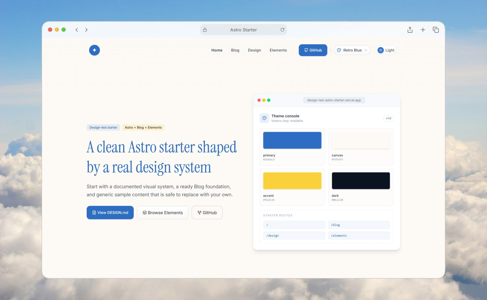

<!-- wasmer:start -->
## Deploy on Wasmer

This folder is the [RicoUI  Starter](https://github.com/ricocc/ricoui-astro-starter) Astro theme by ricocc, copied from commit `dfdfda1869ed4989c2fc91071b0966804dbff033` so it can be deployed as a Wasmer Edge template.

- **Demo:** https://astro-ricoui-astro-starter.wasmer.app
- **Deploy:** open the template on [wasmer.io/templates](https://wasmer.io/templates) and click **Deploy**, or run `wasmer deploy` in this folder. Wasmer installs with pnpm, runs the build script with Node 24 and serves the static `dist/` folder.
- **Changed for Wasmer:**
  - Resized 1 image over 300 KB to at most 1600 px wide, keeping file names and formats.
- **Environment variables:** None.
- **Credit:** theme by [ricocc](https://github.com/ricocc), MIT. The theme's license file is kept unchanged.
<!-- wasmer:end -->

# Design-led Astro Starter

[中文说明](README-zh.md) · [Live generic demo](https://ricoui-astro-starter.vercel.app/)

A reusable Astro 7 starter for content-driven sites. It includes a documented visual system, switchable theme tokens, MDX blog posts, RSS, sitemap support, and an Elements reference page. The deployed demo is the same generic project in this repository; it contains no personal, company, or production-site data.



## Online Preview

Demo：[Live demo](https://ricoui-astro-starter.vercel.app/)
Demo Zh： [Live demo zh](https://ricoui-astro-starter-zh.netlify.app/)


## Themes

The starter ships with 10 swappable theme palettes. They all override the same semantic tokens, so every component keeps working while the mood of the site changes. Retro Blue is the default; the rest are one click away in the theme switcher.

<table>
  <tr>
    <td width="50%" align="center"><br><sub><b>Retro Blue</b><br>Warm editorial blue + gold · default</sub></td>
    <td width="50%" align="center"><br><sub><b>Minimal Mono</b><br>Restrained black, white, warm gray</sub></td>
  </tr>
  <tr>
    <td width="50%" align="center"><br><sub><b>Forest Green</b><br>Calm botanical greens</sub></td>
    <td width="50%" align="center"><br><sub><b>Vellum Ink</b><br>Warm vellum paper + ink</sub></td>
  </tr>
  <tr>
    <td width="50%" align="center"><br><sub><b>Creator Yellow</b><br>Bright creator-economy yellow</sub></td>
    <td width="50%" align="center"><br><sub><b>Precision Orange</b><br>Technical neutral + orange signal</sub></td>
  </tr>
  <tr>
    <td width="50%" align="center"><br><sub><b>Comic Pulp</b><br>Soft pulp comic energy</sub></td>
    <td width="50%" align="center"><br><sub><b>Midnight Pastel</b><br>Dark workspace, muted pastels</sub></td>
  </tr>
  <tr>
    <td width="50%" align="center"><br><sub><b>Sky Blue</b><br>Pale blue-white product</sub></td>
    <td width="50%" align="center"><br><sub><b>Signal Red</b><br>Pragmatic red enterprise accent</sub></td>
  </tr>
</table>

Set `defaultThemeId` in `src/config/themes.js` to choose your default, or turn the theme switcher off for a production site.

## Stack

- Astro 7 and TypeScript
- Tailwind CSS v4 with `@tailwindcss/vite`
- Astro Content Layer, MDX, RSS, and sitemap
- Sharp for local image processing

## Quick start

```bash
pnpm install
pnpm dev
```

The local server runs at `http://localhost:5200`.

## Customize the template

Start with these files. The checked-in values are intentional generic examples, not a real site configuration.

| Location | Change here |
| --- | --- |
| `src/config/site.js` | Site title, canonical URL, SEO metadata, and source link |
| `src/config/themes.js` | Default theme, available theme packs, and semantic tokens |
| `src/styles/global.css` and `src/styles/themes.css` | Base typography and CSS token overrides |
| `src/content/post/` | Sample MDX posts and frontmatter |
| `docs/DESIGN.md` | Visual-system rules for people and coding agents |
| `src/pages/index.astro` | Starter home-page sections and copy |

To use a single fixed theme in a production project, set `showThemeSwitcher` and `persistUserSelection` to `false` in `src/config/themes.js` after choosing `defaultThemeId`.

## Routes

| Route | Purpose |
| --- | --- |
| `/` | Generic starter overview |
| `/blog` | Sample MDX article listing |
| `/blog/[slug]` | Individual article |
| `/design` | Browser view of the design documentation |
| `/elements` | Component and token reference |
| `/rss.xml` | RSS feed |

## Project structure

```text
docs/                 Design-system documentation
public/assets/        Replaceable generic images
src/components/       Reusable sections, cards, UI, and widgets
src/config/           Site and theme configuration
src/content/post/     MDX posts
src/layouts/          Shared page layouts and metadata
src/pages/            Astro routes
src/styles/           Global, theme, and article styles
```

## Build and deploy

```bash
pnpm build
pnpm preview
```

Set `PUBLIC_SITE_URL` to the final deployment URL before building. It controls canonical URLs, the sitemap, RSS, and Open Graph metadata. The official demo uses `https://ricoui-astro-starter.vercel.app/`; deploy this repository unchanged there for theme-directory review, then create a separate deployment after customizing it for your own site.

## License

[MIT](LICENSE)
