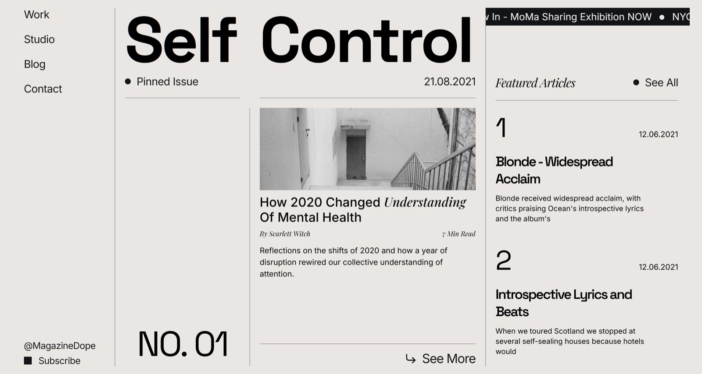

<!-- wasmer:start -->
## Deploy on Wasmer

This folder is the [Self Esteem](https://github.com/m-durana/self-esteem-astro) Astro theme by m-durana, copied from commit `bcd0f2ff70538f2d5bf80f8f8af3d35be71f72d4` so it can be deployed as a Wasmer Edge template.

- **Demo:** https://astro-self-esteem.wasmer.app
- **Deploy:** open the template on [wasmer.io/templates](https://wasmer.io/templates) and click **Deploy**, or run `wasmer deploy` in this folder. Wasmer installs with npm, runs the build script with Node 24 and serves the static `dist/` folder.
- **Changed for Wasmer:**
  - Resized 1 image over 300 KB to at most 1600 px wide, keeping file names and formats.
- **Environment variables:** None.
- **Credit:** theme by [m-durana](https://github.com/m-durana), MIT. The theme's license file is kept unchanged.
<!-- wasmer:end -->

# Self Esteem (Astro Template)



[](https://miro.build/templates/self-esteem)

A magazine-style editorial template built with [Astro](https://astro.build). Original layout by [Aysenur Turk](https://codepen.io/TurkAysenur/pen/gOmMgpx), re-implemented here as a full project.

## Quick start

Scaffold a new project from this template:

```bash
# npm
npm create astro@latest -- --template m-durana/self-esteem-astro

# pnpm
pnpm create astro@latest --template m-durana/self-esteem-astro

# yarn
yarn create astro --template m-durana/self-esteem-astro

# bun
bun create astro@latest --template m-durana/self-esteem-astro
```

Or use the "Use template" button in the top right or clone directly:

```bash
git clone https://github.com/m-durana/self-esteem-astro.git
cd self-esteem-astro
npm install
```

Then:

```bash
npm run dev      # http://localhost:4321
npm run build    # static output to ./dist
```

## Features

- Full-viewport magazine homepage (`/`)
- `/blog` index + `/blog/[slug]` MDX post pages with prev/next
- `/tags/[tag]` pages generated from post frontmatter
- `/studio`, `/contact`, `/work` (data-driven), `/404`
- RSS at `/rss.xml`, OG/Twitter meta in `BaseLayout`
- `PageLayout` + `_template.astro.example` for creating new pages

## Structure

```
src/
├── components/      Menu, Footer, FeaturedArticle, Sidebar, Marquee, Circle, StickyHeader
├── content/         posts/ (md+mdx), featured/, work/
├── content.config.ts
├── layouts/         BaseLayout, PageLayout
├── pages/           index, blog/, tags/, studio, contact, work, 404, rss.xml
└── styles/global.scss
```

See [STYLEGUIDE.md](STYLEGUIDE.md) for tokens, type scale, and a guide for staying on-brand.

## Authoring a post

Drop a `.md` or `.mdx` file in `src/content/posts/`:

```md
---
title: 'Your Article Title'
bigTitle: 'Hero'
emphasis: 'Word' # optional, italicised inside the headline
headline: 'Sharing The {emphasis} Acclaim About Motivation'
excerpt: 'Teaser shown on the cover and in /blog.'
author: 'Jane Doe'
date: 2026-01-01
cover: 'https://images.unsplash.com/...'
tags: ['attention', 'quiet']
featured: true # appear on the magazine cover
pageNumber: 'NO. 01' # optional, used by the sticky header
---

Long-form body.
```

Sidebar entries (`src/content/featured/`) and portfolio items (`src/content/work/`) use smaller schemas; see `content.config.ts`.

## Adding a subpage

Copy `src/pages/_template.astro.example` to `src/pages/<name>.astro`, edit the props, add a link in `src/components/Menu.astro` if it should appear in nav.

## License

MIT License. Original CodePen layout © Aysenur Turk
