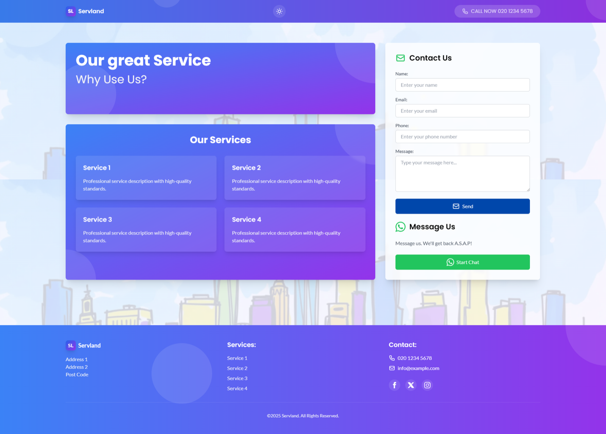

<!-- wasmer:start -->
## Deploy on Wasmer

This folder is the [Servland](https://github.com/locobean/servland) Astro theme by locobean, copied from commit `4fa242e79246e096af5c8c1274cfe5aea84d6ba9` so it can be deployed as a Wasmer Edge template.

- **Demo:** https://astro-servland.wasmer.app
- **Deploy:** open the template on [wasmer.io/templates](https://wasmer.io/templates) and click **Deploy**, or run `wasmer deploy` in this folder. Wasmer installs with npm, runs the build script with Node 24 and serves the static `dist/` folder.
- **Changed for Wasmer:**
  - None. The theme builds as published.
- **Environment variables:** The theme's example env file lists `SMTP_HOST`, `SMTP_USER`, `SMTP_PASS`, `SMTP_PORT`, `PUBLIC_RECAPTCHA_SITE_KEY`, `RECAPTCHA_SECRET_KEY`, `PUBLIC_EMAILJS_SERVICE_ID`, `PUBLIC_EMAILJS_TEMPLATE_ID`, `PUBLIC_EMAILJS_USER_ID`, `PUBLIC_SITE_URL`. The demo builds and runs without them; set them in the app's settings to turn on the features that use them.
- **Credit:** theme by [locobean](https://github.com/locobean), MIT. The theme's license file is kept unchanged.
<!-- wasmer:end -->

# Servland - Business Landing Page Theme

A modern, responsive business landing page theme built with Astro and Tailwind CSS. Perfect for businesses looking for an effective and speedy online presence.



## 🚀 Features

- ⚡️ **Lightning Fast**: Built with Astro for optimal performance
- 🎨 **Beautiful Design**: Modern UI with Tailwind CSS
- 🌗 **Dark Mode**: Automatic and manual dark mode support
- 📱 **Fully Responsive**: Looks great on all devices
- 📧 **Contact Form**: Integrated with EmailJS or Nodemailer
- 💬 **WhatsApp Integration**: Direct messaging capability
- 🍪 **Cookie Consent**: GDPR-compliant cookie banner
- 🖼️ **Parallax Effects**: Engaging background animations
- 🔍 **SEO Ready**: Optimized meta tags and structured data
- 🛠️ **Easy to Customize**: Well-organized code structure

## 🛠️ Quick Start

1. **Clone the repository**
```bash
git clone https://github.com/locobean/servland.git
cd servland
```

2. **Install dependencies**
```bash
npm install
```

3. **Set up environment variables**
```bash
cp .env.example .env
```

4. **Start development server**
```bash
npm run dev
```

Visit `http://localhost:4321` to see your site!

## 📧 Email Configuration

### Option 1: EmailJS (Recommended for Static Sites)

1. Create an account at [EmailJS](https://www.emailjs.com/)
2. Create an email template with variables:
   - `{{name}}` - Sender's name
   - `{{email}}` - Sender's email
   - `{{tel}}` - Phone number
   - `{{message}}` - Message content
3. Add credentials to `.env`:
```env
PUBLIC_EMAILJS_SERVICE_ID=your-service-id
PUBLIC_EMAILJS_TEMPLATE_ID=your-template-id
PUBLIC_EMAILJS_USER_ID=your-public-key
```

### Option 2: Nodemailer with SMTP

1. Configure SMTP settings in `.env`:
```env
EMAIL_USERNAME=your-email@example.com
EMAIL_PASSWORD=your-app-specific-password
RECIPIENT_EMAIL=recipient@example.com
SECRET_KEY=your-secret-key-for-hashing
```

For Gmail, use an [App-Specific Password](https://support.google.com/accounts/answer/185833).

## 🎨 Customization

### Content
- Edit main content in `src/pages/index.astro`
- Modify components in `src/components/`
- Update styles in `tailwind.config.mjs`

### Styling
- Colors: Update `tailwind.config.mjs`
- Typography: Modify font imports in `Layout.astro`
- Components: Edit individual component files

### Images
- Replace `public/preview.png` with your site preview
- Update favicon in `public/favicon.svg`

## 📦 Building for Production

1. **Build the site**
```bash
npm run build
```

2. **Preview the build**
```bash
npm run preview
```

The built files will be in the `dist/` directory.

## 🤝 Contributing

Contributions are welcome! Please read our [Contributing Guide](CONTRIBUTING.md).

1. Fork the repository
2. Create your feature branch
3. Commit your changes
4. Push to the branch
5. Open a Pull Request

## 📄 License

This project is licensed under the MIT License - see the [LICENSE](LICENSE) file for details.

## 💖 Support

- Star this repository
- Report issues
- Follow for updates

---

Made with ❤️ by [locobean](https://github.com/locobean)
