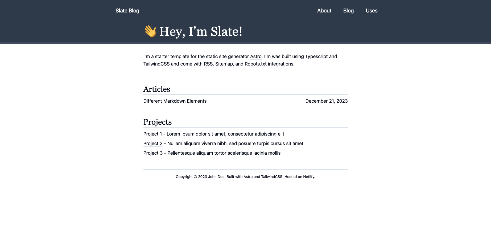

<!-- wasmer:start -->
## Deploy on Wasmer

This folder is the [Slate](https://github.com/jaytyrrell13/astro-template-slate) Astro theme by jaytyrrell13, copied from commit `6de444fdcc300e6be34dd89d928c17551edcbdd1` so it can be deployed as a Wasmer Edge template.

- **Demo:** https://astro-slate.wasmer.app
- **Deploy:** open the template on [wasmer.io/templates](https://wasmer.io/templates) and click **Deploy**, or run `wasmer deploy` in this folder. Wasmer installs with npm, runs the build script with Node 24 and serves the static `dist/` folder.
- **Changed for Wasmer:**
  - Removed files used only by other hosts: netlify.toml.
  - Added .nvmrc with Node 24, the Node version Wasmer builds with.
- **Environment variables:** None.
- **Credit:** theme by [jaytyrrell13](https://github.com/jaytyrrell13), MIT. The theme's license file is kept unchanged.
<!-- wasmer:end -->

# Slate Astro Template



Features:

- [Tailwind integrated](https://docs.astro.build/en/guides/integrations-guide/tailwind/)
- [Sitemap support](https://docs.astro.build/en/guides/integrations-guide/sitemap/)
- [Robots.txt support](https://github.com/alextim/astro-lib/tree/main/packages/astro-robots-txt#readme)
- [RSS Feed support](https://docs.astro.build/en/guides/rss/#_top)
- Markdown support

## Commands

All commands need to be run from the root of the project. The project is setup with `npm`.

```bash
# install dependencies
$ npm i
# start local dev server
$ npm run dev
# build production site
$ npm run build
# preview build locally
$ npm run preview
```

## Support

If you'd like to support the development of this template, you can [buy me a coffee](https://www.buymeacoffee.com/jaytyrrell).
