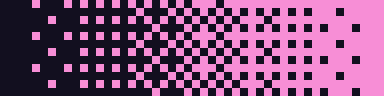

Most of my sketches end up in two colours. A limit like that makes me decide what matters in a picture. Ordered dithering is how I get gradients back without giving up the limit.

## The idea

You compare each pixel's brightness with a threshold. With plain thresholding every pixel uses the same value, so a gradient turns into one hard edge. Ordered dithering takes the threshold from a small repeating matrix instead. Neighbouring pixels get different thresholds, and the eye blends them into a tone.



_A left to right gradient with a 4x4 Bayer matrix. Every pixel is either fully on or fully off._

## The shader

```glsl
#version 300 es
precision highp float;

uniform sampler2D u_image;
uniform float u_scale;
out vec4 outColor;

const float bayer[16] = float[16](
   0.0,  8.0,  2.0, 10.0,
  12.0,  4.0, 14.0,  6.0,
   3.0, 11.0,  1.0,  9.0,
  15.0,  7.0, 13.0,  5.0
);

void main() {
  vec2 cell = floor(gl_FragCoord.xy / u_scale);
  ivec2 i = ivec2(mod(cell, 4.0));
  float threshold = (bayer[i.x + i.y * 4] + 0.5) / 16.0;
  vec3 src = texture(u_image, gl_FragCoord.xy / vec2(textureSize(u_image, 0))).rgb;
  float lum = dot(src, vec3(0.2126, 0.7152, 0.0722));
  outColor = vec4(vec3(step(threshold, lum)), 1.0);
}
```

`u_scale` makes the dither pixels bigger than screen pixels. I usually run it at 3 or 4, which reads as "pixel art" rather than "printer".

> [!NOTE]
> The `+ 0.5` centres each threshold inside its sixteenth. Without it, pure black still lights one pixel in every 4x4 block.

## Matrix sizes

| Matrix | Levels | Look                        |
| :----- | -----: | :-------------------------- |
| 2x2    |      5 | Chunky, visible crosshatch  |
| 4x4    |     17 | My default                  |
| 8x8    |     65 | Smooth, close to a halftone |

Bigger is not always better. The 8x8 version looks smoother, but the pattern stops being part of the picture. I like seeing the grid.
