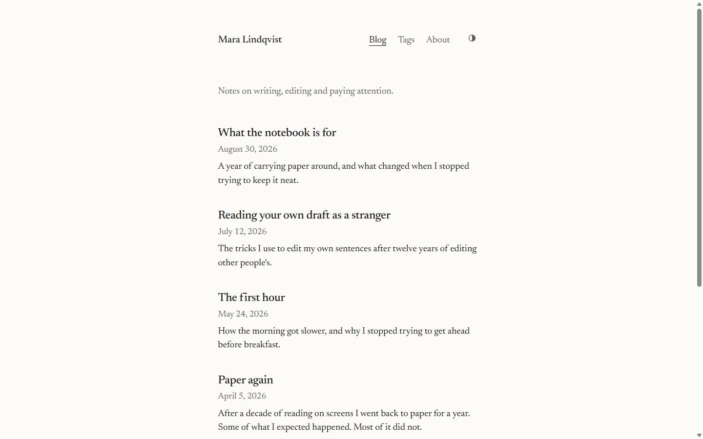

<!-- wasmer:start -->
## Deploy on Wasmer

This folder is the [Tessera Plain](https://github.com/HeviSlav/tessera-plain) Astro theme by HeviSlav, copied from commit `b2c4e80e9e9ded10bc493ec289d2d0ded0ba6d58` so it can be deployed as a Wasmer Edge template.

- **Demo:** https://astro-tessera-plain.wasmer.app
- **Deploy:** open the template on [wasmer.io/templates](https://wasmer.io/templates) and click **Deploy**, or run `wasmer deploy` in this folder. Wasmer installs with npm, runs the build script with Node 24 and serves the static `dist/` folder.
- **Changed for Wasmer:**
  - None. The theme builds as published.
- **Environment variables:** None.
- **Credit:** theme by [HeviSlav](https://github.com/HeviSlav), MIT. The theme's license file is kept unchanged.
<!-- wasmer:end -->

# Plain

A minimalist blog theme for [Astro](https://astro.build), made for people who write. One column of text set in a serif face, generous line height, and almost no chrome: no cards, no hero, no shadows, no gradients. Dark mode follows the system and can be toggled. The only client side JavaScript is the theme toggle, and every page is static HTML.



## Features

- One text column, 65 to 70 characters wide, set in Newsreader (self hosted, SIL Open Font License)
- Light and dark themes: system preference by default, a toggle that persists, no flash on load
- Posts in Markdown or MDX with footnotes, tables, figures and code blocks that switch theme with the page
- Front page with pagination, tag pages, an about page written in Markdown, a 404 page
- RSS feed with full post content, sitemap, robots.txt and Open Graph tags on every page
- Semantic landmarks, skip link, visible focus rings, reduced motion respected, contrast above 4.5:1 in both themes
- Hand written prose styles on Tailwind 4, no typography plugin, no icon or font packages

## Quick start

```sh
npm install
npm run dev
```

Open `http://localhost:4321`. `npm run build` writes the site to `dist/`, `npm run preview` serves that folder, and `npm run check` runs `astro check`.

## Writing a post

Add a Markdown file to `src/content/blog/`. The file name becomes the URL, so `src/content/blog/paper-again.md` is served at `/blog/paper-again/`.

```md
---
title: "Paper again"
description: "One line shown in the post list, in search results and in the feed."
date: 2026-04-05
updated: 2026-04-20
tags: [reading, attention]
draft: false
---

The post starts here. Footnotes[^1], tables, code blocks and raw HTML all work.

[^1]: Footnotes are rendered by GitHub flavored Markdown.
```

`updated` and `draft` are optional. Draft posts are visible while running `npm run dev` and left out of the build. For a figure with a caption, write the HTML directly:

```html
<figure>
  
  <figcaption>The caption.</figcaption>
</figure>
```

Images go in `public/images/`. Give every image a width and height so the page does not shift while it loads.

The about page is `src/content/pages/about.md`.

## Configuration

Everything you are likely to change lives in `src/config.ts`: language, site title, description, production URL, author, header navigation, footer links, copyright name, posts per page, and the `credit` switch for the "Made with Plain" line in the footer.

Colors live at the top of `src/styles/global.css` as CSS variables, one set for light and one for dark. Prose styles are in the same file under `.prose`. The font is loaded from `public/fonts/`; swap the `@font-face` rules and the `--font-serif` stack to use another face.

`npm run og` regenerates `public/og.png`, the image used for link previews. It is a plain mark with no text, so it works for any site title.

## Deployment

The build is static, so any host that serves files works. Set `url` in `src/config.ts` to the address you deploy to; it is used for canonical links, the sitemap and the RSS feed.

- Cloudflare Pages: build command `npm run build`, output directory `dist`
- Netlify: build command `npm run build`, publish directory `dist`
- Vercel: framework preset Astro, or build command `npm run build` with output directory `dist`
- GitHub Pages: use the official [Astro action](https://docs.astro.build/en/guides/deploy/github/); Plain assumes it lives at the root of a domain, so a project site under a subpath also needs `base` in `astro.config.mjs` and prefixed links

## License

MIT. The Newsreader font is licensed separately under the SIL Open Font License, see `public/fonts/OFL.txt`.

## More themes

Plain is free and maintained by [Tessera](https://tessera.hevislav.workers.dev), a small studio that also makes premium Astro themes. If you need more than a blog, have a look at [Meridian](https://meridian-demo.hevislav.workers.dev), an editorial marketing site theme for SaaS and startups.
