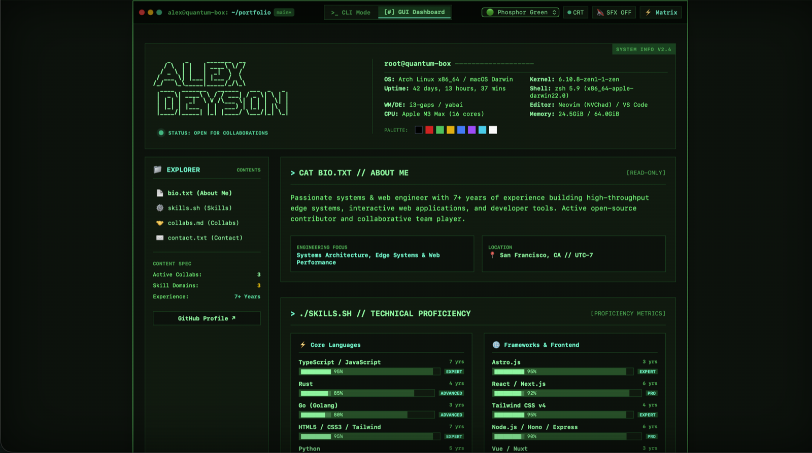
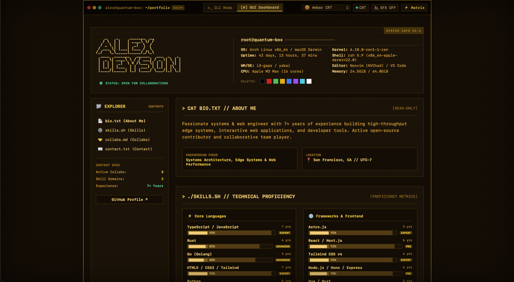
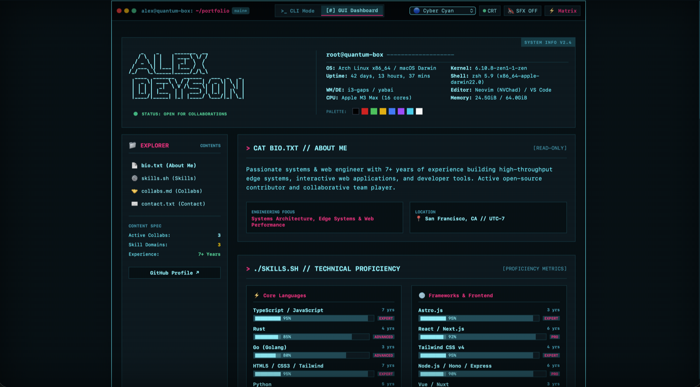
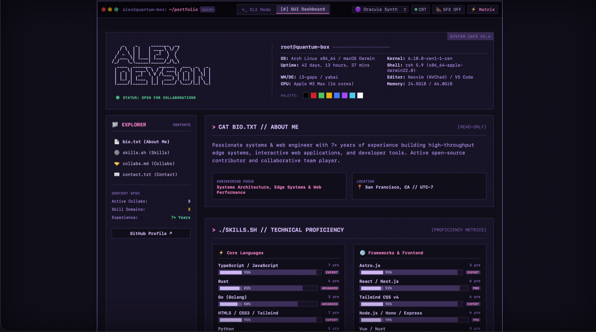
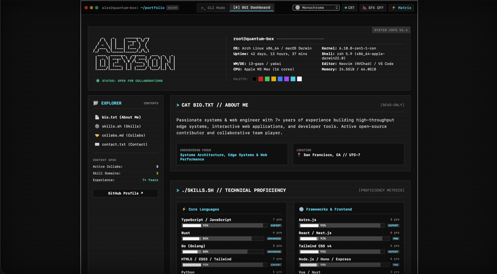
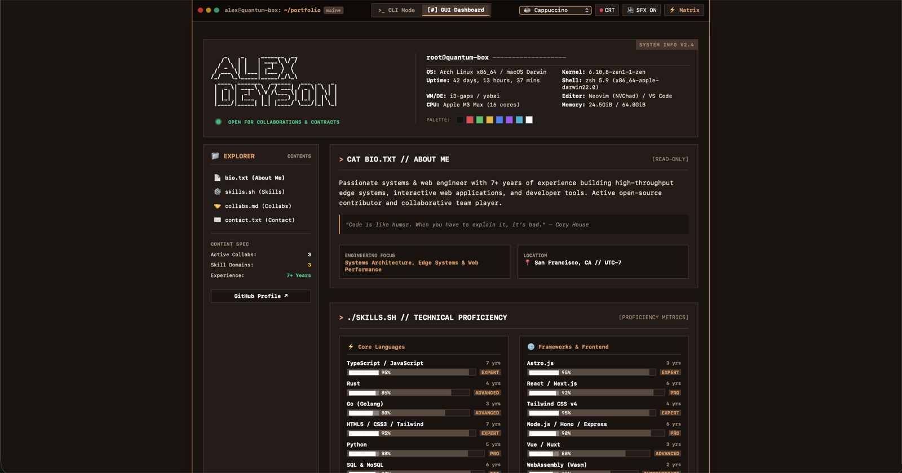
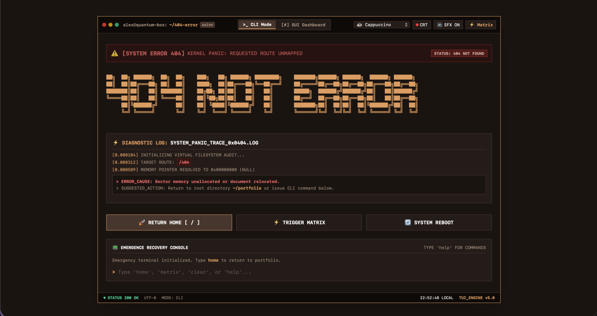
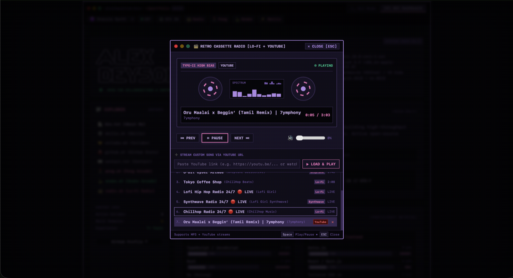
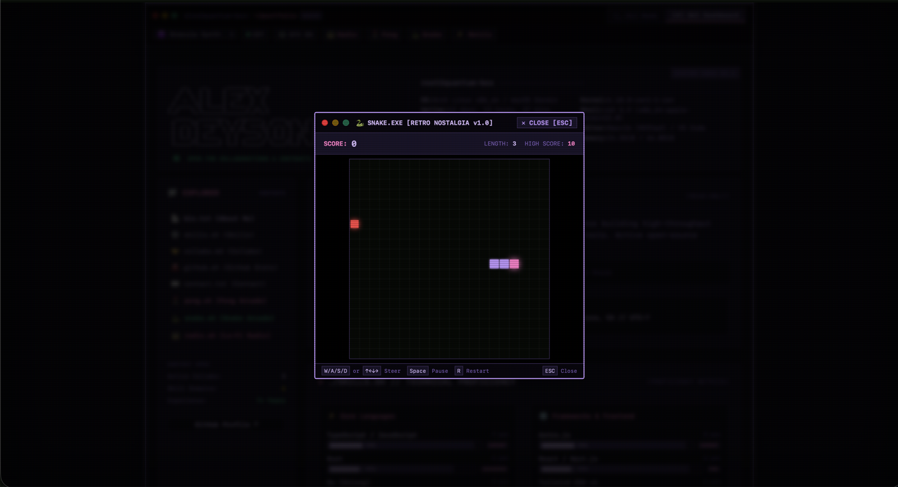
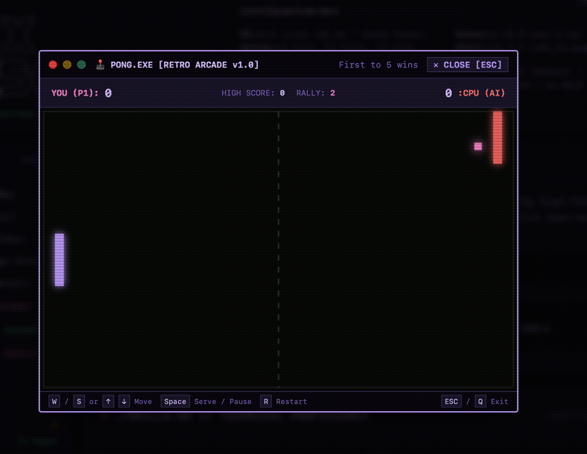

<!-- wasmer:start -->
## Deploy on Wasmer

This folder is the [Retro TUI Portfolio](https://github.com/nivinvysakh/astro-tui-portfolio) Astro theme by nivinvysakh, copied from commit `0512b64ba94af15ddaf5dcc9218b1a695b2fa770` so it can be deployed as a Wasmer Edge template.

- **Demo:** https://astro-tui-portfolio.wasmer.app
- **Deploy:** open the template on [wasmer.io/templates](https://wasmer.io/templates) and click **Deploy**, or run `wasmer deploy` in this folder. Wasmer installs with npm, runs the build script with Node 24 and serves the static `dist/` folder.
- **Changed for Wasmer:**
  - Resized 11 images over 300 KB to at most 1600 px wide, keeping file names and formats.
  - Added .nvmrc with Node 24, the Node version Wasmer builds with.
- **Environment variables:** None.
- **Credit:** theme by [nivinvysakh](https://github.com/nivinvysakh), MIT. The theme's license file is kept unchanged.
<!-- wasmer:end -->

<div align="center">

# 🖥️ Retro TUI Portfolio

A minimal, high-aesthetic Terminal User Interface portfolio template.  
Built with **Astro.js v7** & **Tailwind CSS v4**.

<br />

[](https://astro.build)
[](https://tailwindcss.com)
[](https://www.typescriptlang.org)
[](https://portal.astro.build/themes/retro-tui-portfolio/)
[](LICENSE.MD)

<br />
<br />

[](https://app.netlify.com/start/deploy?repository=https%3A%2F%2Fgithub.com%2Fnivinvysakh%2Fastro-tui-portfolio)

<br />
<br />

<p align="center">
  <a href="https://astro-tui-portfolio.netlify.app"><strong>🌐 Launch Live Demo</strong></a> &nbsp;•&nbsp;
  <a href="https://portal.astro.build/themes/retro-tui-portfolio/"><strong>🌟 Available on Astro Themes</strong></a>
</p>

</div>

<br />

> 🌟 **Available on Astro Themes:** This theme is officially listed and available on the [Astro Theme Directory](https://portal.astro.build/themes/retro-tui-portfolio/).

---

## 🌐 Live Preview

Experience the interactive retro terminal portfolio live in your browser:
- 🔗 **Live Demo**: [https://astro-tui-portfolio.netlify.app](https://astro-tui-portfolio.netlify.app)
- 🌟 **Astro Themes Directory**: [retro-tui-portfolio on Astro Themes](https://portal.astro.build/themes/retro-tui-portfolio/)

---

## 🎮 Video Demo

https://github.com/user-attachments/assets/b48b7e89-4402-48b1-a201-9028e0d75327

---

## 🎨 Retro CRT Themes

Switch between **6 built-in CRT themes** in real-time via the header dropdown or the `theme <name>` CLI command:

| **🟢 Phosphor Green** | **🟠 Amber CRT** |
| :---: | :---: |
|  |  |

| **🔵 Cyber Cyan** | **🟣 Dracula Synth** |
| :---: | :---: |
|  |  |

| **⚪ Monochrome** | **☕ Cappuccino** |
| :---: | :---: |
|  |  |

<p align="center">
  <em>Includes a custom retro 404 terminal error screen:</em>
</p>

<div align="center">
  
</div>

---

## 📻 Retro Cassette Radio & 24/7 Live Streams

An interactive retro cassette tape player with real-time Web Audio API spectrum visualization:
- **Curated Tracks**: Built-in Lo-Fi, Chiptune, Synthwave, and Ambient tracks.
- **24/7 Live Streams**: Includes 24/7 live YouTube radio streams (Lofi Girl 🔴 LIVE, Synthwave 🔴 LIVE, Chillhop 🔴 LIVE).
- **Custom Song Streaming**: Stream any song or live radio from YouTube by pasting the video URL into the player or executing `radio add <url>` in CLI.
- **Infinite Live Duration**: Displays `00:00 / ∞` for 24/7 live stream stations.

<div align="center"></div>

---

## 🐍 Retro Arcade Snake (`./snake.sh`)

A classic 60 FPS HTML5 Canvas Snake arcade mini-game built right into the terminal:
- **Controls**: Play using `W/A/S/D`, Arrow keys, or mobile D-Pad touch buttons (▲ ◀ ▼ ▶).
- **Sound Effects**: Web Audio API sound synthesis for eating apples, steering, and game-over alerts.
- **High Scores**: Persistent high-score tracking stored in browser `localStorage`.


<div align="center"></div>

---

## 🕹️ Retro Arcade Pong (`./pong.sh`)

A 1972-style 60 FPS HTML5 Canvas Pong arcade mini-game vs CPU AI:
- **Controls**: Steer your paddle using `W/S`, `↑/↓` Arrow keys, Mouse drag, or mobile touch controls.
- **Rally & Score Counter**: Real-time rally counter and persistent high-score tracking.


<div align="center"></div>

---

## 🐙 Live GitHub Repositories & Metrics

Real-time integration with the GitHub REST API:
- **Live Metrics**: Automatically fetches total stars ⭐, total forks 🍴, followers count 👥, and public repository statistics.
- **Language Breakdown**: Displays primary programming languages across all public repositories.
- **Featured Repositories Grid**: Interactive cards displaying repository stars, description, and direct links.

<div align="center"></div>

### 🖥️ GitHub CLI Integration (`github` / `repos`)

Access live GitHub metrics and featured repositories directly inside the terminal CLI:
- **CLI Commands**: Execute `github` (or `gh` / `stats`) to view live profile metrics, or `repos` (or `projects`) to browse top repositories.
- **Interactive Terminal Cards**: Formatted terminal output displaying repository stars, forks, language badges, and direct links.

<div align="center"></div>

---

## ✨ Key Features

- **Dual-Mode UI** — Switch between an interactive **`>_ CLI Terminal`** (history, tab autocomplete) and a **`[#] GUI Dashboard`**.
- **📻 Retro Lo-Fi Radio + 24/7 Live Radio Streams** — Cassette radio with Web Audio API real-time spectrum visualizer, 24/7 Live Lofi Girl / Synthwave streams, & custom YouTube URL loader.
- **🐍 Retro Arcade Snake & 🕹️ Pong** — Fully playable 60 FPS HTML5 Canvas arcade games with sound synthesis, zero-latency touch controls, and persistent high-scores.
- **📱 100% Mobile & Touch Optimized** — Pinned window headers, touch D-Pad controls, centered cassette player, and responsive layout for mobile screens (Samsung Galaxy S23 FE, iPhones, Android).
- **🐙 Live GitHub Stats & Repos** — Real-time GitHub REST API metrics: total stars ⭐, forks 🍴, followers, languages breakdown & repositories.
- **6 Vintage CRT Themes** — Phosphor Green, Amber, Cyber Cyan, Dracula Synth, Monochrome, and Cappuccino with dynamic runtime CSS variables.
- **CRT Shader & Audio FX** — Scanline overlays, vignette shadows, and Web Audio API keypress sounds.
- **Live Activity Streaming** — Optional Discord Lanyard WebSocket integration for Spotify activity and live gaming status (disabled by default).
- **Zero-Backend Contact Form** — Working AJAX email transmission via FormSubmit.co with confetti celebration.
- **100% Static & Fast** — Built with Astro v7 for instant load times and zero overhead.

---

## 🚀 Quick Start

```bash
# Clone and install
git clone https://github.com/nivinvysakh/astro-tui-portfolio.git
cd astro-tui-portfolio
npm install

# Start local dev server
npm run dev
```

Open **`http://localhost:4321`** to view your live portfolio.

> **🐳 Docker:** Run `docker compose up tui-portfolio-dev` for live development with hot-reloading.

---

## ⚙️ Customization

- **Content & Bio** &rarr; [`src/data/portfolio.ts`](src/data/portfolio.ts)  
  *Update bio, skills matrix, hardware specs, collaborations, and contact details.*

- **Themes, Radio & Integrations** &rarr; [`src/config/`](src/config/)  
  *Configure custom CRT themes (`themeConfig.ts`), Radio tracks & 24/7 Live Streams (`radioConfig.ts`), Spotify RPC (`spotifyConfig.ts`), and live Gaming presence (`gamesConfig.ts`).*
  > 💡 **Note:** Spotify and Gaming live activity widgets are disabled by default until configured with your Discord Lanyard User ID (`lanyardUserId: ""`).

- **🎵 Adding Custom Radio Tracks & Streams**:
  - **Permanent Playlist (Config)**: Add MP3 URLs or YouTube links to the `RADIO_PLAYLIST` array in [`src/config/radioConfig.ts`](src/config/radioConfig.ts).
  - **Runtime via UI / CLI**: Paste any YouTube URL into the Radio window's *STREAM CUSTOM SONG VIA YOUTUBE URL* input field, or execute `radio add <youtube_url>` directly in the CLI terminal. Custom streams persist in browser `localStorage`.

---

## 💻 CLI Commands

| Command | Description |
| :--- | :--- |
| `help` | List available commands (`man`) |
| `about` | Bio, background & location (`cat bio.txt`) |
| `skills` | Interactive proficiency meters (`cat skills.sh`) |
| `collabs` | Projects & collaborations (`cat collabs.md`) |
| `neofetch` | System specs & ASCII art logo |
| `github` | Live GitHub profile metrics, stars & language stats (`stats`, `gh`) |
| `repos` | Explore featured repositories with stars & links (`projects`) |
| `links` | Display quick links to LinkedIn, X (Twitter), GitHub & Email (`socials`) |
| `snake` | Play classic retro Snake arcade game (`./snake.sh`) |
| `pong` | Play retro arcade Pong vs CPU (`game`, `play`, `./pong.sh`) |
| `radio` | Play Lo-Fi radio or stream 24/7 Live YouTube stations (`radio add <yt_url>`, `radio play`) |
| `spotify` | Live Spotify track & progress bar (`np`) |
| `theme <name>` | Switch theme (`green`, `amber`, `cyan`, `dracula`, `mono`, `cappuccino`) |
| `matrix` | Toggle digital rain canvas animation |
| `crt` / `sfx` | Toggle CRT shader / Keypress sound effects |
| `gui` / `cli` | Switch layout mode |
| `clear` | Clear terminal screen buffer (`cls`) |

---

## 📄 License

Distributed under the [MIT License](LICENSE.MD). © 2026 Nivin
