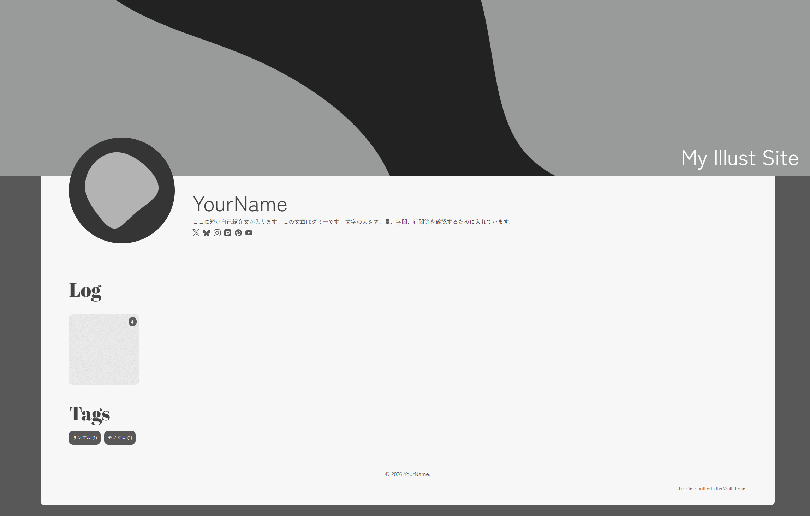
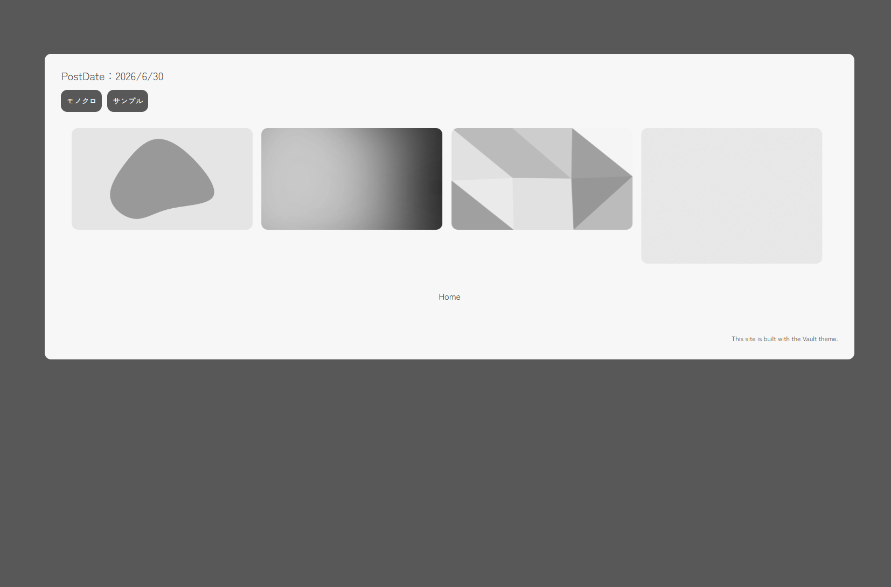

<!-- wasmer:start -->
## Deploy on Wasmer

This folder is the [Vault](https://github.com/hilava999/Vault) Astro theme by hilava999, copied from commit `d0d04a8e2d922a11cb16534051e9d43950697ced` so it can be deployed as a Wasmer Edge template.

- **Demo:** https://astro-vault.wasmer.app
- **Deploy:** open the template on [wasmer.io/templates](https://wasmer.io/templates) and click **Deploy**, or run `wasmer deploy` in this folder. Wasmer installs with npm, runs the build script with Node 24 and serves the static `dist/` folder.
- **Changed for Wasmer:**
  - Resized 2 images over 300 KB to at most 1600 px wide, keeping file names and formats.
- **Environment variables:** None.
- **Credit:** theme by [hilava999](https://github.com/hilava999), MIT. The theme's license file is kept unchanged.
<!-- wasmer:end -->

# Vault
### 🖼️ Astro製のイラスト作品の展示・ログ向けテーマ
Markdownファイルと画像を追加するだけで、作品ページを自動生成できます。
イラストの保管庫（Vault）のように、作品をシンプルにまとめられることを目指して開発しました。

[](https://nodejs.org/) [](https://astro.build/) 

[🖥️デモサイト](https://vault-livedemo.pages.dev/)




## コンセプト
Vault は、イラスト作品をシンプルに整理・公開するための Astro テーマです。作品の追加は Markdown ファイルと画像を配置するだけ。作品管理に手間をかけず、創作そのものに集中できることを目指しています。


## ✨️ 特徴
- Astro Content Collections を利用した作品管理
- Markdown + 画像だけで作品ページを自動生成
- Masonryレイアウト
- PhotoSwipeによる画像拡大表示
- タグ機能
- コンフィグファイルによる簡単なサイト設定
- OGP対応
- レスポンシブ対応


## 📦️ 動作環境
- Node.js　22以上
- Astro   7.x


## 🚀 インストール
```bash
git clone https://github.com/hilava999/Vault.git

cd Vault

npm install

npm run dev
```


## ⚙️ 初期設定
`src/config/siteConfig.ts` を編集してください。

設定できる項目

- サイトタイトル
- サイト説明
- テーマカラー
- ヘッダー画像
- アイコン画像
- プロフィール
- SNSリンク
- OGP画像


## 🖼️ 作品の追加方法

フォルダを `src/content/log` に作成し、作品を入れてください。

例

```text
src/content/log/

001/
├ index.md
├ image1.webp
├ image2.webp

002/
├ index.md
├ image.webp
```

各フォルダ内に `index.md` を作成し、作品情報を記述します。同じフォルダ内の画像は自動で取得され、ギャラリーとして表示されます。

`index.md`の記入例

```markdown
---
date: YYYY-MM-DD
cover: ./cover.png
tags: ["タグ1","タグ2"]
---
```

- date → 投稿日、必須
- cover → サムネイル画像の指定、必須
- tags → タグ、任意

## ❗️注意事項
> デプロイ前に `src/config/siteConfig.ts` を編集し、サイトタイトルやプロフィール、SNSリンクなどをご自身の情報へ変更してください。

### OGPについて
OGP画像を正しく表示させるために`astro.config.mjs` の`site`に自分のサイトURLを設定してください。

## ☁️ デプロイ
### Cloudflare Pages(推奨)
|項目|設定値|
|---|---|
|Framework preset|Astro|
|Build command|`npm run build`|
|Build output directory|`dist`|

他、Netlify、Vercelなどの静的ホスティングに対応しています。詳しくは[Astroのドキュメント](https://docs.astro.build/ja/getting-started/)をご確認ください。

## 📷️ スクリーンショット
### トップページ


### 作品ページ



## 📝 ライセンス
MIT License

### クレジットについて

トップページにクレジットを置いていますが、表示するか否かは任意です。デザイン上、邪魔に感じましたら削除しても構いません。削除する場合は、`/src/pages/index.astro`の以下のコードを削除してください。

```astro
<CreditLink />
```


## 🙏 使用ライブラリ
- Astro
- PhotoSwipe
- MiniMasonry
- Astro Icon


## 🐞 不具合・要望

不具合報告や機能要望は Issue よりお気軽にお知らせください。


## ⭐️ 最後に
このテーマが皆さんの創作活動のお役に立てれば嬉しいです。