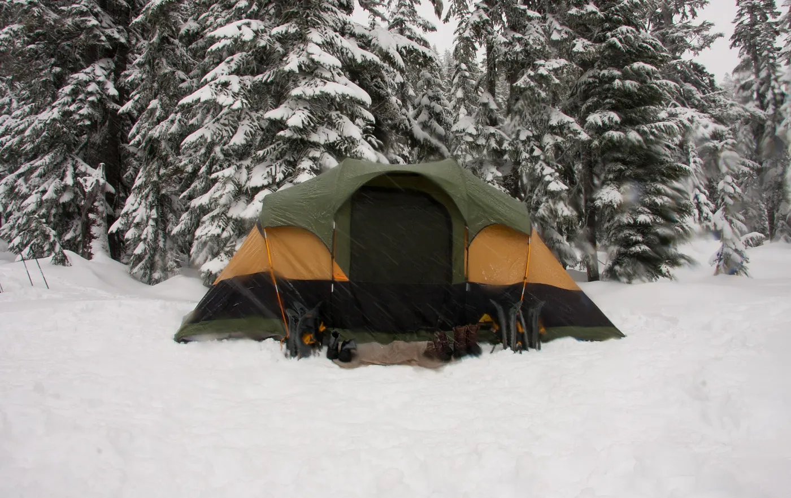

The first time we tested Ridgeline with a trail crew, a sawyer named Dee held her phone up to the sky, waited, and put it back in her pocket. She was not looking for a signal. She was showing me that she had stopped looking years ago.

Most software treats offline as an error state: a gray banner, a spinner, a retry button. For the people we build for, offline is *the normal state*, and a connection is a nice surprise at the trailhead.

## Assume the signal drops

We flipped the default. Every screen in Ridgeline renders from what is already on the device, and the network only ever adds to it. No screen waits on a request. If a sync fails, nothing on screen changes; the next one picks up where it left off.

### What the network is for

The network does two jobs: it brings in what other crews wrote since the last sync, and it sends out what this crew wrote. Neither job blocks the screen, and neither one is ever shown as a failure.

## Cache the next three miles

When a crew opens a trail, we fetch the tiles and reports for the segment they are on and the three miles ahead. It turned out three miles is about a morning of work, and about 6 MB.

```js
// Prefetch the segment ahead while there is still a signal
const ahead = trail.segmentsFrom(position, { miles: 3 });
for (const segment of ahead) {
  await cache.put(segment.tilesUrl, { priority: "high" });
  await cache.put(segment.reportsUrl);
}
```

The order matters. Tiles first, because a map with stale reports is still useful, and reports without a map are not.

## Readable in full sun

Contrast guidelines are written for offices. On a snowfield at noon, 4.5:1 is the floor, not the goal. We pushed every map label past 7:1, dropped the thin weights, and made the "you are here" mark a solid shape instead of a pulsing ring.



> The best offline feature is the one nobody notices, because nothing ever looked broken.
>
> Dee Halvorsen, trail crew lead

## Saying less on screen

Gloves, rain and a pack strap over one shoulder change what a good interface is. We kept to a few rules:

- Every action on the main screen is reachable with a thumb, at the bottom.
- Nothing important is a swipe or a long press.
- A sync status lives in one place, in words: "Saved on this phone" beats an icon.

### What we cut

A live crew map, a chat tab and a photo feed all made it into a prototype, and all three came out before the field test. Each one needed a signal to be useful, and each one made the screen busier for the hours when there was none.

## What I would do again

Go to the field before writing a line of code. Two days on a trail crew changed more of Ridgeline than a month of interviews. If you are building for people outside, *go outside with them*.
