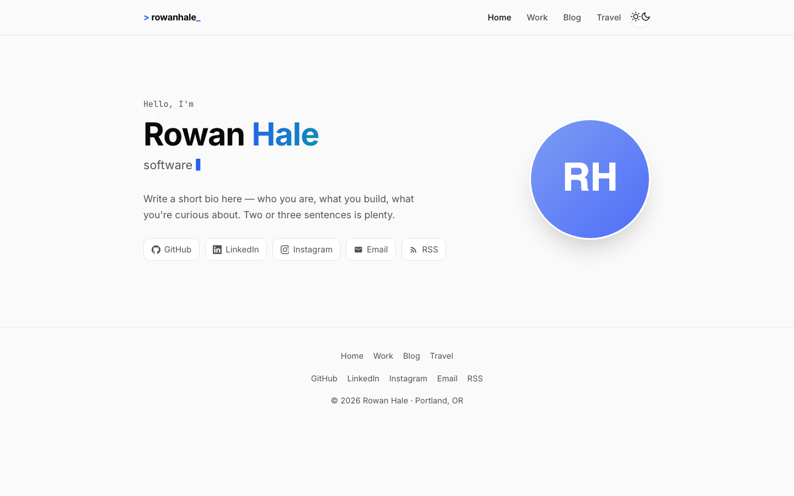

<!-- wasmer:start -->
## Deploy on Wasmer

This folder is the [Astro Wanderer](https://github.com/igagansingh/astro-wanderer) Astro theme by igagansingh, copied from commit `06415fa918a5af526303a8e459f41a2d4a5c5058` so it can be deployed as a Wasmer Edge template.

- **Demo:** https://astro-wanderer.wasmer.app
- **Deploy:** open the template on [wasmer.io/templates](https://wasmer.io/templates) and click **Deploy**, or run `wasmer deploy` in this folder. Wasmer installs with npm, runs the build script with Node 24 and serves the static `dist/` folder.
- **Changed for Wasmer:**
  - Removed the GitHub Pages sub-path `base: '/astro-wanderer'` from astro.config.mjs, so assets load at the root of the Wasmer app.
- **Environment variables:** None.
- **Credit:** theme by [igagansingh](https://github.com/igagansingh), MIT. The theme's license file is kept unchanged.
<!-- wasmer:end -->

# Astro Wanderer

A personal site theme for [Astro](https://astro.build) — portfolio, blog, and travel photo galleries in one quiet, fast template.

**[Live demo](https://igagansingh.com/astro-wanderer)**



## Why Wanderer

Most developer portfolios stop at the work page. Wanderer is built around the idea that a good personal site shows what you're like *when you're not working* — so it ships with a travel section where every trip is a story with a photo carousel and lightbox, right next to your résumé and blog.

## Features

- **Home** — hero with a typing animation, avatar, and social links
- **Work** — expandable experience timeline, education, and skill groups, all from one data file
- **Blog** — markdown posts with tags, tag pages, prev/next navigation, reading time, and drafts
- **Travel** — trip entries with hero images, highlight badges, photo carousel, lightbox with keyboard navigation, and optional video support
- **Zero JS by default** — only three tiny scripts (theme toggle, typing effect, gallery); no framework runtime
- **Dark/light mode** — respects `prefers-color-scheme`, remembers your choice, no flash on load
- **SEO ready** — canonical URLs, Open Graph/Twitter cards, JSON-LD structured data, sitemap, RSS feed
- **Accessible** — semantic HTML, skip-free keyboard navigation in galleries, `aria` labels throughout
- **One config file** — name, socials, bio, and résumé all live in plain TypeScript data files
- **100/100 Lighthouse** out of the box on a static build

## Quick start

Use this template with the Astro CLI:

```sh
npm create astro@latest -- --template igagansingh/astro-wanderer
```

Or clone it directly:

```sh
git clone https://github.com/igagansingh/astro-wanderer.git
cd astro-wanderer
npm install
npm run dev
```

Then open `src/data/site.ts` — it's the single source of truth for your name, tagline, social links, and production URL. The sample post in `src/content/blog/getting-started.md` walks through everything else.

## Project structure

```
├── public/
│   └── img/              # avatar, og image, trip photos
├── src/
│   ├── components/       # Header, Hero, Gallery, PostCard, …
│   ├── content/
│   │   ├── blog/         # markdown posts
│   │   └── trips/        # markdown trip stories
│   ├── data/
│   │   ├── site.ts       # ← edit this first
│   │   └── resume.ts     # experience, education, skills, typing roles
│   ├── pages/            # index, work, blog, travel, 404, rss
│   └── styles/global.css # design tokens + all styling (no framework)
└── astro.config.mjs      # set your production URL here
```

## Writing content

### Blog post

Create a markdown file in `src/content/blog/`:

```md
---
title: My first post
subtitle: An optional subtitle
date: 2026-01-15
tags: [notes]
category: tech        # or life
description: One-liner for cards and SEO.
draft: false          # true hides the post from builds
---

Your words here.
```

### Trip entry

Create a markdown file in `src/content/trips/`, drop photos into `public/img/trips/<trip>/`, and list them:

```md
---
title: Kyoto, 2026
place: Kyoto, Japan
date: 2026-04-10
summary: One line for the card.
heroImage: /img/trips/kyoto/hero.jpg
circlePhotos:                 # photos for the rotating ring
  - /img/trips/kyoto/torii.jpg
gallery:
  - /img/trips/kyoto/hero.jpg
highlights:
  - Fushimi Inari at sunrise
---

Story body here.
```

Photos in `gallery` get a carousel with a click-to-open lightbox, thumbnail strip, fullscreen mode, and arrow-key navigation. `.mp4`/`.webm` files are supported alongside images.

## Customization checklist

1. `src/data/site.ts` — name, description, URL, socials
2. `src/data/resume.ts` — roles, education, skills, hero typing words
3. `public/img/avatar.svg` → your photo · `public/img/og.jpg` → a 1200×630 share card
4. `astro.config.mjs` — set `site` to your production URL, and set (or remove) `base`
5. Write real content, then delete the two sample posts and sample trip

## Deploy

The included `.github/workflows/deploy.yml` builds and deploys to GitHub Pages on every push to `main`. In your repo settings, set **Settings → Pages → Source** to **GitHub Actions**.

### Hosting at a subpath (e.g. `username.github.io/my-repo`)

Keep `base: '/my-repo'` in `astro.config.mjs`. All internal links and assets are routed through a single `withBase()` helper, so everything just works. The deploy workflow automatically nests the build output under your base path so GitHub Pages resolves it. This is how the [live demo](https://igagansingh.com/astro-wanderer) is hosted.

### Hosting at the domain root (`example.com`)

Remove the `base` line from `astro.config.mjs`. The workflow detects this and ships the output un-nested.

Any static host works too — Netlify, Vercel, Cloudflare Pages — just point the build command at `npm run build` with output `dist/`.

## Commands

| Command           | Action                                    |
| :---------------- | :---------------------------------------- |
| `npm run dev`     | Start local dev server                    |
| `npm run build`   | Production build to `./dist/`             |
| `npm run preview` | Preview the production build locally      |
| `npm run check`   | Type-check the project                    |

## Credits

Built by [Gagan Singh](https://igagansingh.com) with [opencode](https://opencode.ai) — every part of this template, from the design tokens to the photo lightbox, was written pair-programming style with an AI coding agent.

## License

MIT — free for personal and commercial use. If it saved you an afternoon, a star or a link back is always appreciated.
